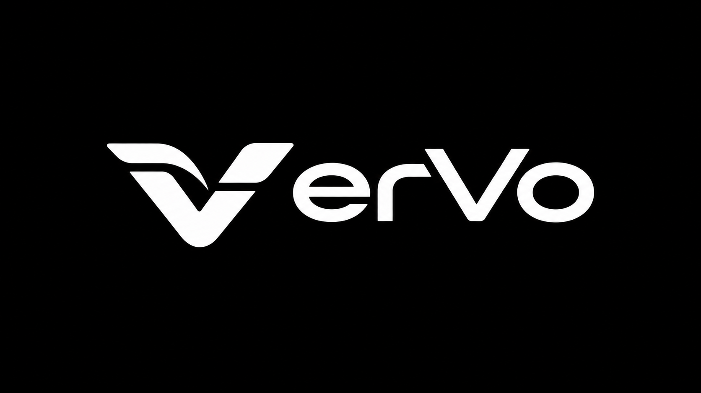

 

## ♦ Bienvenidos a VerVo

Somos una empresa apasionada por la tecnología, enfocada en construir experiencias de usuario únicas, sistemas seguros y soluciones de software eficientes. Nuestro objetivo es aportar a la comunidad tecnológica, por lo que **en este espacio estaremos subiendo herramientas totalmente gratis y funciones extras** a través de nuestros repositorios de código abierto.

### 💎 &nbsp;Sobre nosotros

- 💡 **Nuestro Enfoque:** Nos apasiona diseñar arquitecturas limpias y desarrollar soluciones escalables, integrando herramientas de IA para optimizar procesos corporativos y creativos.
- 🎁 **Comunidad y Open Source:** A través de este GitHub liberamos herramientas de uso libre y módulos adicionales que puedes integrar directamente en tus proyectos sin costo.
- 🌱 **Innovación Continua:** Profundizamos constantemente en Inteligencia Artificial, Diseño de Sistemas y Ciberseguridad (CISCO) para ofrecer código seguro y moderno.
- 🤝 **Nuestra Visión:** Democratizar el acceso a software de alta calidad y fomentar el crecimiento colaborativo en el mundo del desarrollo.

---

### 🛠️ &nbsp;Tecnologías y Herramientas

En VerVo hemos estructurado un stack de desarrollo robusto, abarcando desde interfaces interactivas hasta arquitecturas seguras en la nube:

#### Frontend & Diseño

#### Backend & Lenguajes

#### Bases de Datos & Arquitectura

#### Ciberseguridad & Sistemas

---

### 📫 &nbsp;Conecta con nosotros

💬 No dudes en contactarnos si deseas implementar nuestras herramientas, colaborar en un proyecto, consultar por nuestros servicios o simplemente hablar de tecnología.

